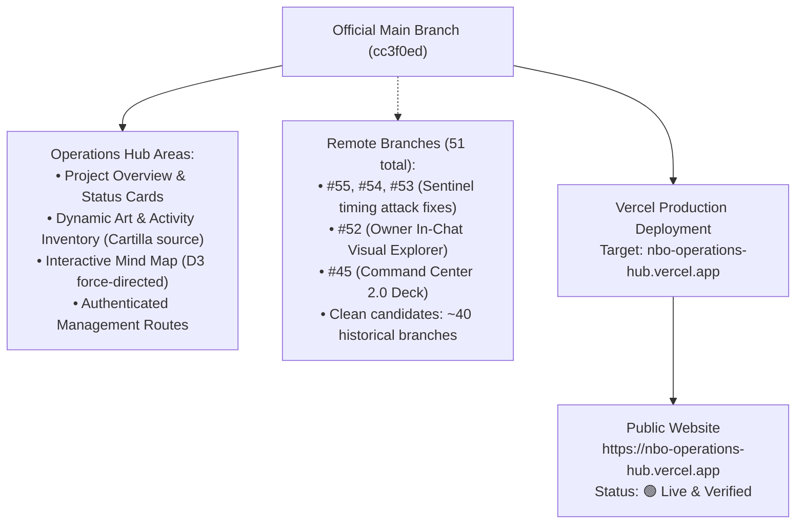
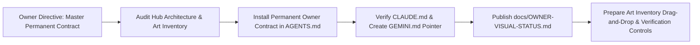

# OWNER VISUAL STATUS — NBO OPERATIONS HUB

**Repository:** `https://github.com/ejnburrows-rgb/Command-Center-`  
**Production URL:** [https://nbo-operations-hub.vercel.app](https://nbo-operations-hub.vercel.app)  
**Art Inventory URL:** [https://nbo-operations-hub.vercel.app/art-inventory](https://nbo-operations-hub.vercel.app/art-inventory)  
**Last Checked Date:** 2026-11-07  
**Official Main Revision:** `cc3f0ed` (feat(hub): integrate daily focus and project progress tracking)  
**Active Production Revision:** `cc3f0ed` (dpl_BygMzfrP6Luv9ybmqDGu6SJee5Gq)  
**Production Status:** 🟢 **Synchronized with official main.**

---

## 1. Complete Repository & Release Map

---

## 2. Current Session Work Map

---

## 3. Branch and Merge Status
- **Official Source:** `main` (`cc3f0ed`)
- **Open Pull Requests (Sample):**
  - PR #55, #54, #53: Sentinel timing attack security fixes
  - PR #52: `docs: owner-approved in-chat visual repository explorer`
  - PR #48: `⚡ Bolt: Fast Date Sorting`
  - PR #47: `🎨 Palette: Improve login form accessibility`
  - PR #45: `feat: NBO Command Center 2.0`
- **Total Remote Branches:** 51 branches.

---

## 4. Current Approved Work & Hub Overview
- **Project Overview:** `DONE and live` (Verified on production).
- **Art Inventory Viewer:** `DONE and live` (Reads directly from canonical Cartilla repository).
- **Interactive Mind Map:** `DONE and live` (Verified on production).
- **Artwork Upload & Approval Suite:** `WAITING` (Enhancement planned per Section 9).
