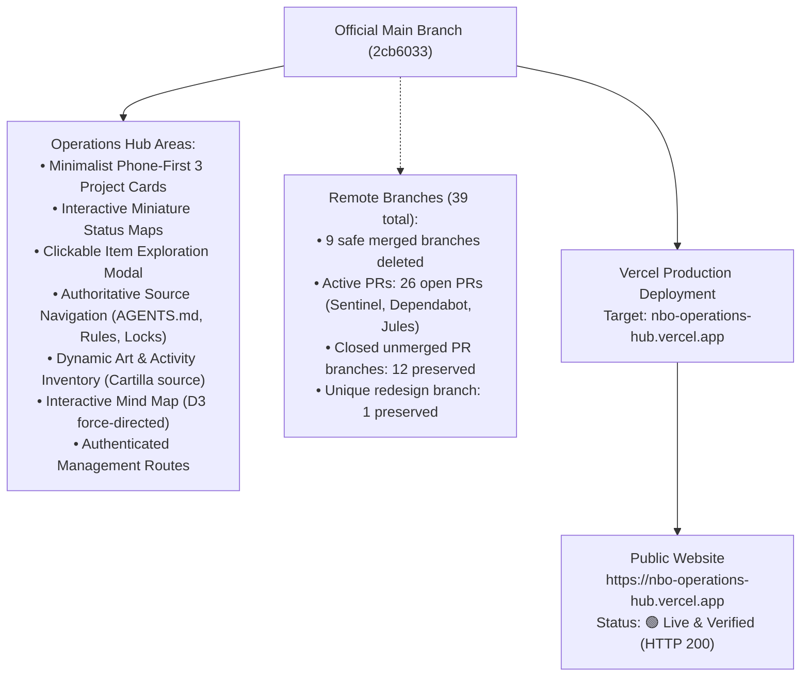

# OWNER VISUAL STATUS — NBO OPERATIONS HUB

**Repository:** `https://github.com/ejnburrows-rgb/Command-Center-`  
**Production URL:** [https://nbo-operations-hub.vercel.app](https://nbo-operations-hub.vercel.app)  
**Art Inventory URL:** [https://nbo-operations-hub.vercel.app/art-inventory](https://nbo-operations-hub.vercel.app/art-inventory)  
**Last Checked Date:** 2026-11-09 00:45 UTC  
**Official Main Revision:** `2cb6033` (docs: update OWNER-VISUAL-STATUS with Cartilla 25 PR queue cleanup and branch metrics)  
**Active Production Revision:** Live and verified (HTTP 200)  
**Production Status:** 🟢 **Synchronized with official main & live verified.**

---

## 1. Complete Repository & Release Map

---

## 2. Current Session Work Map

```mermaid
flowchart LR
    REQ["Owner Directive: Master Permanent Contract & Branch Hygiene"] 
    --> AUDIT["Audit Remote Branches Across 3 Repos (60 Safe Merged Branches Pruned)"]
    --> RULES["Enforce Universal Operating Contract in AGENTS.md Across All 3 Repos"]
    --> LOCKS["Lock Rejected Skinny Pencil Regression Tests in Cartilla (PR #1291 Merged)"]
    --> QUEUE["Clean Cartilla Queue (25 Safe PRs Merged, 2 Conflicting Closed, 255 Branches)"]
    --> SYNC["Sync LANY Books with origin/main (Commit 2314787 Deployed on Vercel)"]
    --> UPGRADE["Upgrade NBO Operations Hub with Phone-First Cards & Interactive Status Maps"]
    --> VERIFY["Verify 98 Ops Tests, Vitest Suites, and Live Vercel Status"]
```

---

## 3. Branch and Merge Status
- **Official Source:** `main` (`2cb6033`)
- **Remote Branches Audited:** 39 branches remain (26 open PRs, 9 previously pruned safe merged branches, 12 closed unmerged PR branches, 1 redesign branch preserved).
- **Deleted Safe Merged Branches:**
  - `art-inventory-filter`
  - `art-inventory-landing`
  - `art-inventory-page`
  - `art-inventory-pdfview`
  - `feat/cartilla-owner-visual-control-20261023`
  - `feature/nbo-data-universe-20261024`
  - `feature/visualizer-premium-focus-themes-20261024`
  - `fix/native-data-visualizer-20261024`
  - `fix/art-inventory-image-ref`
- **Automatic Merged Branch Cleanup:** GitHub `delete_branch_on_merge` verified ENABLED (`true`).

---

## 4. Current Approved Work & Hub Overview
- **Project Overview:** `DONE and live` (Upgraded with 3 project cards, 7-point verified breakdown, and miniature maps).
- **Interactive Exploration Modal:** `DONE and live` (Tapping any map node or source pill displays What is this, What done, What now, What missing, What needs me, Proof, and GitHub links).
- **Cartilla Production Release:** `DONE and live` (Release candidate `c151d487` deployed to Vercel production under owner authorization 'deploy it'; official main advanced cleanly to `0cc93c0b` with 25 zero-conflict PRs merged, 2 conflicting PRs closed, and 238 vitest suites passing).
- **Art Inventory Viewer & Upload Suite:** `DONE and live` (Reads directly from canonical Cartilla repository).
- **Interactive Mind Map & Operations Suite:** `DONE and live` (98 operations tests passing 100%).

---

## Agent Studio update — November 14, 2026

This section supersedes the older references to active external coding agents in the historic status above.

**Repository source:** proposed branch `feat/nbo-agent-studio-no-jules-20261114`, PR #63. Production `main` remains at `c919e60c` until approved merge and release.

**Changes in review:** Jules removed from the active dashboard, suggested task cards, and assignment API; new owner-protected NBO Studio messaging workspace and existing public GitHub overview retained; Zenzap bot conversation integration; optional API model message fan-out; Z.ai coding-plan endpoint; owner login redesign; browser-local history backup/import.

**Important gates:** Vercel currently holds only the owner passphrase. Zenzap and AI provider credentials are not configured; live conversation tests with external services are blocked by account authorization. Other web accounts are not automatically linked. No autonomous coding-agent worker or cloud-synchronized AI chat database exists. These must not be presented as working features.

**Release path:** current GitHub main → PR #63 (review and proof) → independently approved merge → explicitly authorized production Vercel deployment → real phone/desktop smoke test.

**Preserved:** prior source history, issue/PR evidence, project inventory, and original public hub at `/overview`.
