# OWNER VISUAL STATUS — NBO OPERATIONS HUB

**Repository:** `https://github.com/ejnburrows-rgb/Command-Center-`  
**Production URL:** [https://nbo-operations-hub.vercel.app](https://nbo-operations-hub.vercel.app)  
**Art Inventory URL:** [https://nbo-operations-hub.vercel.app/art-inventory](https://nbo-operations-hub.vercel.app/art-inventory)  
**Last Checked Date:** 2026-11-08 20:00 UTC  
**Official Main Revision:** `c048dff` (feat(hub): upgrade to phone-first minimalist 3-project overview with clickable exploration and status maps)  
**Active Production Revision:** Live and verified (HTTP 200)  
**Production Status:** 🟢 **Synchronized with official main & live verified.**

---

## 1. Complete Repository & Release Map

---

## 2. Current Session Work Map

```mermaid
flowchart LR
    REQ["Owner Directive: Master Permanent Contract & Branch Hygiene"] 
    --> AUDIT["Audit Remote Branches Across 3 Repos (60 Safe Merged Branches Pruned)"]
    --> RULES["Enforce Universal Operating Contract in AGENTS.md Across All 3 Repos"]
    --> LOCKS["Lock Rejected Skinny Pencil Regression Tests in Cartilla (PR #1291 Merged)"]
    --> SYNC["Sync LANY Books with origin/main (Commit 2314787 Deployed on Vercel)"]
    --> UPGRADE["Upgrade NBO Operations Hub with Phone-First Cards & Interactive Status Maps"]
    --> DEPLOY["Deploy Cartilla Production Release (Commit c151d487 / dpl_7ULi6oiQYPiexTDVLYTpdnhSHCAj Verified Live)"]
    --> VERIFY["Verify 98 Ops Tests, Vitest Suites, and Live Vercel Status"]
```

---

## 3. Branch and Merge Status
- **Official Source:** `main` (`c048dff`)
- **Remote Branches Audited:** 47 branches inspected -> 9 safe merged branches deleted -> 38 branches remain.
- **Deleted Safe Merged Branches:**
  - `art-inventory-filter`
  - `art-inventory-landing`
  - `art-inventory-page`
  - `art-inventory-pdfview`
  - `feat/cartilla-owner-visual-control-20261023`
  - `feature/nbo-data-universe-20261024`
  - `feature/visualizer-premium-focus-themes-20261024`
  - `fix/native-data-visualizer-20261024`
  - `fix/art-inventory-image-ref`
- **Automatic Merged Branch Cleanup:** GitHub `delete_branch_on_merge` verified ENABLED (`true`).

---

## 4. Current Approved Work & Hub Overview
- **Project Overview:** `DONE and live` (Upgraded with 3 project cards, 7-point verified breakdown, and miniature maps).
- **Interactive Exploration Modal:** `DONE and live` (Tapping any map node or source pill displays What is this, What done, What now, What missing, What needs me, Proof, and GitHub links).
- **Cartilla Production Release:** `DONE and live` (Release candidate `c151d487` deployed to Vercel production under owner authorization 'deploy it'; live deployment verified with HTTP 200 OK on `https://cartilla-de-gretel-ejn.vercel.app` and `https://cartilla-de-gretel-psi.vercel.app`).
- **Art Inventory Viewer & Upload Suite:** `DONE and live` (Reads directly from canonical Cartilla repository).
- **Interactive Mind Map & Operations Suite:** `DONE and live` (98 operations tests passing 100%).
