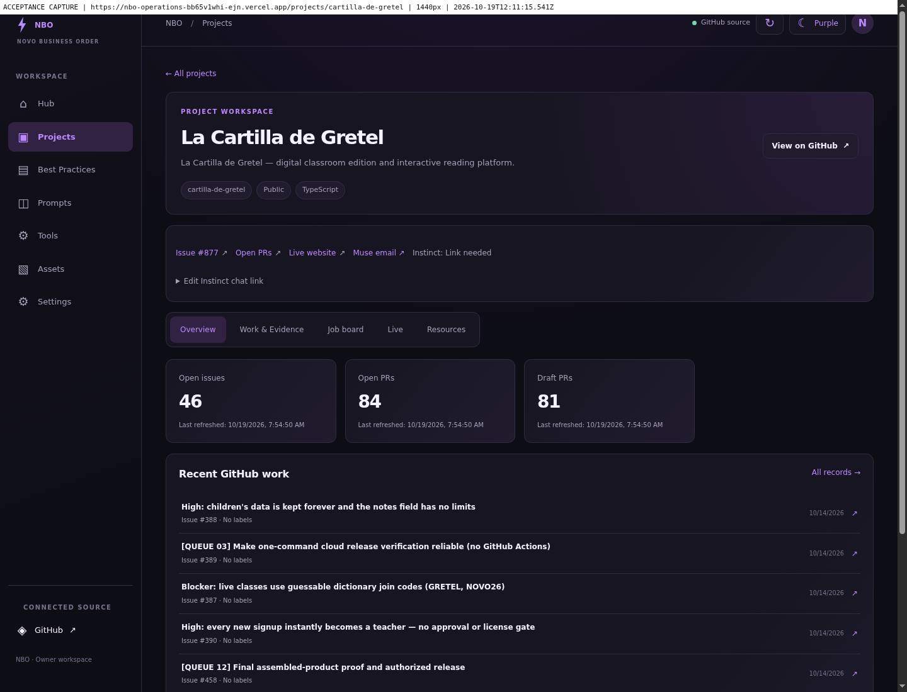
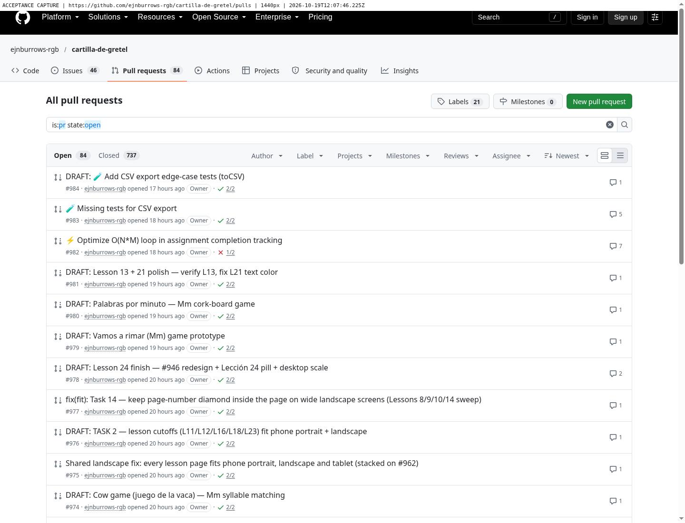
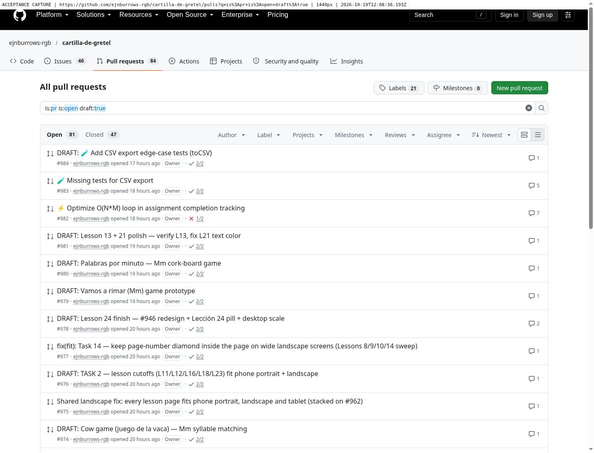
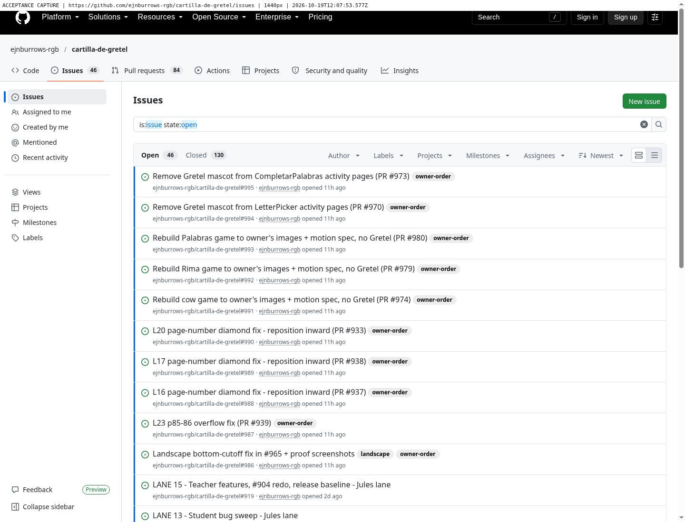

# NBO-HUB-v1.0 — numbered acceptance evidence

Status: **VERIFIED** for REQ-1 through REQ-7. Verification means the Hub behavior passed its checks; it does not certify Cartilla's implementation, merges or deployment.

- [Open tested preview](https://nbo-operations-bb65v1whi-ejn.vercel.app/)
- [Branch preview](https://nbo-operations-hub-git-feature-nbo-hub-20261017-ejn.vercel.app/)
- [Draft PR #9](https://github.com/ejnburrows-rgb/Command-Center-/pull/9)
- Tested application commit: `707f6e32557ffb3cbb472ec1aa7d4fb6954bd449`.
- Vercel preview deployment: `dpl_8PXKXcsAtAt1S1ctwQe7Pp7oDN6z`; preview target, never production.
- [Download screenshot and browser-result bundle](https://backend.composio.dev/api/v3/sl/fYTpT432Ci).
- [Baseline](00-baseline.md), [browser results](browser-results.json), [backend tests](backend-final-tests.txt), [live-check security tests](live-final-tests.txt), [Anti-Churn receipt](anti-churn-receipt.json), [optimized build](build.txt).

The final review captures below all come from the exact tested preview above, at 1440×1100 and **390×1100** browser viewports. A test-only annotation shows the actual page URL, viewport width and capture time; it is not part of the application. Phone tests are browser viewport tests, not a physical Android-device test. Earlier screenshots are retained as supporting evidence, with their actual source URL and time recorded in browser-results.json.

| # | Requirement / exact preview | Desktop | Exactly 390px | Result |
|---|---|---|---|---|
| 1 | [Routes and history](https://nbo-operations-bb65v1whi-ejn.vercel.app/projects/cartilla-de-gretel/work) | [Screenshot](review-req1-desktop.jpg) | [Screenshot](review-req1-mobile.jpg) | **VERIFIED** — distinct routes, address changes, active sidebar, fresh deep link, reload, Back/Forward, controlled 404 |
| 2 | [Complete GitHub counts](https://nbo-operations-bb65v1whi-ejn.vercel.app/projects/cartilla-de-gretel) | [Screenshot](review-req2-desktop.jpg) | [Screenshot](review-req2-mobile.jpg) | **VERIFIED** — all pages, correct categories, drafts, real source timestamp, cache, errors, manual refresh and 120-second polling |
| 3 | [Pins](https://nbo-operations-bb65v1whi-ejn.vercel.app/) | [Pinned](review-req3-desktop.jpg) / [unpinned](req3-unpinned-desktop.jpg) | [Pinned](review-req3-mobile.jpg) / [unpinned](req3-unpinned-mobile.jpg) | **VERIFIED** — owner selection only, independent control, Home filtering, all Projects retained, reload/theme persistence |
| 4 | [Live site](https://nbo-operations-bb65v1whi-ejn.vercel.app/projects/cartilla-de-gretel/live) | [Screenshot](review-req4-desktop.jpg) | [Screenshot](review-req4-mobile.jpg) / [404 failure](req4-failure-mobile.jpg) | **VERIFIED** — save/reload/recheck, actual HTTP status, Last-Modified provenance, honest unknown build age, safe redirects, failures and timeout |
| 5 | [Canonical jobs](https://nbo-operations-bb65v1whi-ejn.vercel.app/projects/cartilla-de-gretel/jobs) | [Screenshot](review-req5-desktop.jpg) | [Screenshot](review-req5-mobile.jpg) | **VERIFIED** — all five canonical jobs, paginated comments, explicit source/PR links, missing evidence, red unsupported completion claims |
| 6 | [Project quick links](https://nbo-operations-bb65v1whi-ejn.vercel.app/projects/cartilla-de-gretel/resources) | [Screenshot](review-req6-desktop.jpg) | [Screenshot](review-req6-mobile.jpg) | **VERIFIED** — supplied destinations, mailto recipient, editable Link needed state, custom URL persistence, project isolation |
| 7 | [Needs you](https://nbo-operations-bb65v1whi-ejn.vercel.app/) | [Real feed](review-req7-desktop.jpg) / [labeled fixture](req7-fixture-desktop.jpg) | [Real feed](review-req7-mobile.jpg) / [labeled fixture](req7-fixture-mobile.jpg) | **VERIFIED** — only eligible requests with visual proof; one included / one missing-proof case excluded; real feed correctly empty |

All rows correspond to implementation in the tested application commit linked above. Evidence-only commits after that commit do not change its runtime files.

## 1. Routing sequence

Actual clicking sequence: Home → Projects → Cartilla → Work → Resources → Back to Work → Back to Overview → Forward to Work. The nested Work route then survived reload and a fresh tab plus reload. The active main navigation was Projects. All 130 records were available in Work.

Sequential screenshots: [Work](history-1-work.jpg) → [Resources](history-2-resources.jpg) → [Back](history-3-back.jpg) → [Forward](history-4-forward.jpg). Their actual URLs and capture times are in browser-results.json. Invalid `/projects/not-a-repo/work` returned HTTP 404 and the controlled “Page not found” view.

All top-level/Best Practices routes were tested. All 30 project overview/work/jobs/live/resources routes were tested at 1440px. The 39-route phone sweep tested all projects and the main sections at exactly 390px: every route returned 200 and none had horizontal overflow. No uncaught JavaScript exceptions occurred during final navigation. Canceled Next.js prefetch requests during deliberate page changes were recorded separately from application failures.

## 2. Independent GitHub reference

At **2026-10-19 12:09:46.786 UTC / 08:09:46.786 America/New_York**, independent GitHub requests returned **84 open PRs, 81 drafts, 46 actual issues**, matching the Hub. The issues endpoint required two pages: 100 + 30 records; PRs are excluded from the actual issue total. The dedicated PR endpoint provided draft state.

| Hub | GitHub PRs | GitHub drafts | GitHub issues |
|---|---|---|---|
|  |  |  |  |

Reference endpoints: [issues page 1](https://api.github.com/repos/ejnburrows-rgb/cartilla-de-gretel/issues?state=open&per_page=100&page=1), [issues page 2](https://api.github.com/repos/ejnburrows-rgb/cartilla-de-gretel/issues?state=open&per_page=100&page=2), [PRs](https://api.github.com/repos/ejnburrows-rgb/cartilla-de-gretel/pulls?state=open&per_page=100).

The source fetch timestamp remained `2026-10-19T11:54:50.221Z` across subsequent client polls. It was not replaced with the later poll time. Public successful snapshots use Next's persistent cache (30 minutes), with local request deduplication. A cold start does not justify claiming a fresh GitHub fetch. Work payloads are sent only for the selected project. Rate-limit, partial-page and overlapping-page failures are tested with fixtures. A browser network-abort test retained 46/84/81 with the original timestamp and visible STALE labels, then recovered after Retry/Refresh. A clock installed before application initialization established a successful scheduled request at 120 seconds; manual refresh also returned 200.

## 3. Pins and existing local features

No default project is pinned. Pinning Cartilla added it to Home; reload preserved it; a purple/teal theme change retained it; unpinning removed it from Home while leaving Projects unchanged. Browser storage uses the new versioned `nbo-pins-v1` key.

Existing prompt copy wrote text to the clipboard. A newly created test prompt and a checked During checklist item survived reload. Theme survived route navigation and reload. Existing browser data keys were retained. Test data was confined to the acceptance browser.

## 4. Live status and provenance

The deployed Hub's real HTTP HEAD check of `https://cartilla-de-gretel.vercel.app/` returned 200. Its response supplied HTTP Last-Modified `Thu, 15 Oct 2026 19:32:29 GMT`. This is a resource header, **not** a deployment date. The connected Vercel project/alias/deployment reads did not establish that hostname's deployed revision. Therefore the UI says **BUILD AGE UNKNOWN**, deployed commit Unknown, deployment timestamp Unknown. The owner's reported October 16 build is not presented as established fact.

The live URL survived save/reload. An unavailable hostname returned a clear failure. HTTP 404 remained an actual 404. A redirect toward 127.0.0.1 was rejected; an intentionally delayed site was stopped in about 8 seconds. HTTPS-only hostnames, no credentials, port 443, checked public IPv4 DNS answers, pinned socket lookup, validated redirects and bounded timeouts protect the health checker. HTTP cache age is never treated as build age. Unsupported IPv6-only hosts are rejected rather than bypassing address checks.

## 5. Canonical job evidence

Issue #877's body supplies the five names: Index card wording; Lesson 3 as the archetype; Voice; Flip chart look; Rollout. All 531 comments present during verification were paginated. Only explicitly identified, unambiguous single-job reports establish associations; loose lesson numbers and other-repository PRs do not attach. The latest applicable report per job is assessed.

The real feed currently shows five UNVERIFIED job statuses because acceptance proof is absent. Independent GitHub states remain visible: Job 2 has PR #920 OPEN; Jobs 4 and 5 have merged PRs #901 and #902. This does not certify their functionality or deployment. No screenshot or self-reported passed test automatically becomes VERIFIED/LIVE. Owner wording for the flip-chart selection remains visible. Missing PR/proof is explicit. Existing work and source issue content were not rewritten.

## 6. Quick links

Issue #877, public PRs and the supplied live site each opened the correct destination with HTTP 200. Muse uses exactly `mailto:ejnrcgplm@gmail.com`; no email was sent. No trusted actual Instinct chat URL was available, so the UI shows editable **Link needed**, not a file-share substitute. A clearly synthetic example.com test value survived reload; it was removed afterward. An unrelated project's resource screen had zero Cartilla #877 links.

## 7. Approval inclusion and exclusion

The real source yielded no approvals meeting the proof contract, so Home reads “No evidenced approvals waiting.” A backend fixture with two explicit merge requests accepted the proof-backed open-PR case and rejected the missing-proof case. That backend result was served to the **actual preview UI only through a test-browser route interception**. Exactly one card rendered. Screenshots prominently label this a synthetic fixture, not a real owner request. The interception was removed and the real empty feed rechecked. Nothing was merged or published by opening cards.

## Preservation and limitations

- Main remains `5a8c49bcf56e2bf5d2fca2cdaaf9af0592414355`; no main push or production promotion.
- PR #8 remains a separate draft at `e5a666d25b5601d4ce3ba3b3017890f972a7cb7f`, unmerged.
- System Map implementation is preserved in `app/legacy-project-view.tsx`; it is absent from prominent navigation. Generic guidance remains in Best Practices. Repeated Home cards and Next Actions were replaced without deleting their guidance.
- The source repository remains private. Public Hub data uses unauthenticated, allowlisted repository reads, checks public metadata and never exposes a GitHub credential. No new dependencies or services were added.
- The missing actual Instinct chat URL and unknown Cartilla deployment provenance remain explicit data gaps. No physical Android device was used. GitHub data is cached up to 30 minutes for rate-limit protection, with honest timestamps.
- No Cartilla code or job-board body changes. The only authorized cross-repository write is the final evidence-summary comment.
